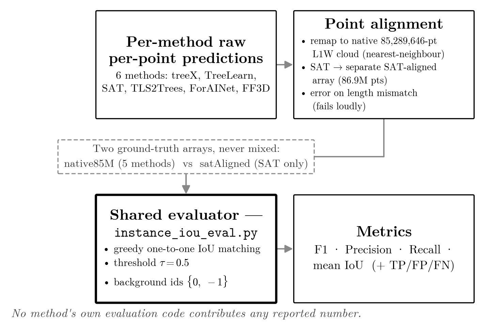
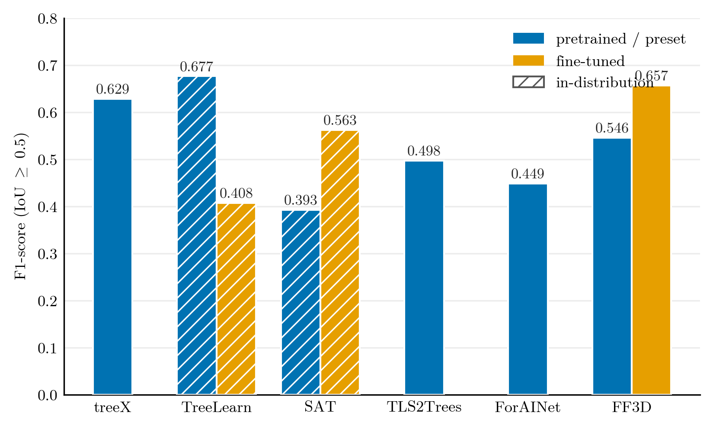
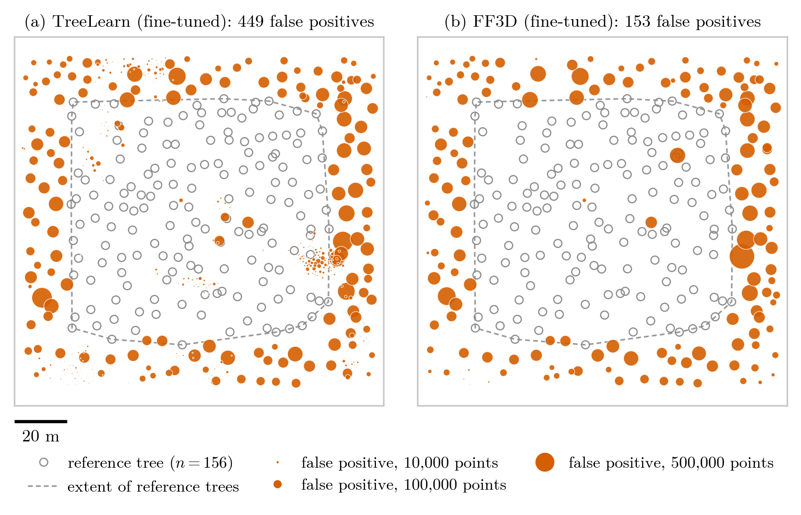

# Individual tree segmentation on LiDAR: an evaluation benchmark

Evaluation framework and results from my MSc dissertation (Data Science & AI, University of Liverpool, 2025/26): a like-for-like comparison of six deep learning and rule-based methods for segmenting individual trees from dense mobile LiDAR point clouds.

Every method is scored by the **same evaluator** on the **same plot** (TreeLearn L1W: 85.3M points, 156 manually verified reference trees), so the numbers are directly comparable.



## Evaluation protocol

Each method outputs a per-point instance label. `evaluation/instance_iou_eval.py` compares it with the ground truth:

1. Background points (ids `0` and `-1`) are excluded when building instances.
2. IoU is computed for every ground-truth/prediction pair that overlaps.
3. Pairs are matched greedily, highest IoU first, one-to-one, keeping only pairs with IoU ≥ 0.5.
4. Matched pairs are true positives; unmatched predictions are false positives; unmatched reference trees are false negatives.
5. Reported: precision, recall, F1 and mean IoU of matched pairs.

The evaluator ships with unit tests on small synthetic point clouds whose answers can be checked by hand.

## Results

| Method | Setting | Precision | Recall | F1 | Matched / 156 |
|---|---|---|---|---|---|
| treeX | Rule-based (no training) | 0.466 | 0.968 | 0.629 | 151 |
| TreeLearn | Pretrained | 0.511 | 1.000 | 0.677 | 156 |
| TreeLearn | Fine-tuned | 0.257 | 0.994 | 0.408 | 155 |
| SAT | Pretrained | 0.251 | 0.904 | 0.393 | 141 |
| SAT | Fine-tuned | 0.399 | 0.955 | 0.563 | 149 |
| TLS2Trees | Pretrained | 0.333 | 0.981 | 0.498 | 153 |
| ForAINet | Pretrained | 0.311 | 0.808 | 0.449 | 126 |
| FF3D | Pretrained | 0.382 | 0.955 | 0.546 | 149 |
| FF3D | Fine-tuned | 0.497 | 0.968 | 0.657 | 151 |



### Are the false positives really errors?

The 156 reference trees do not cover every tree in the plot, so a correct prediction of an unannotated tree counts as a false positive. `analysis/verify_boundary_fp.py` re-scores every method, separating predictions that fall on annotated trees from those on unannotated points. Discounting the latter (rule B in `results/summary.csv`) gives F1 between 0.68 and 0.99: most "false positives" come from incomplete annotation rather than segmentation mistakes. Confidence intervals for the differences between methods come from a spatial block bootstrap (`analysis/block_bootstrap.py`, block size chosen from Moran's I in `analysis/correlation_scale.py`).



## Repository layout

| Path | Contents |
|---|---|
| `evaluation/` | The evaluator and its unit tests |
| `analysis/` | False-positive verification, spatial bootstrap, hardest trees, threshold sensitivity, plus the SLURM scripts used on the Barkla HPC cluster |
| `results/` | Aggregated outputs: per-method summary, bootstrap intervals, hardest trees |
| `figures/` | Figures from the dissertation |

## Running it

With Docker (runs the unit tests by default):

```bash
docker build -t tree-seg-eval .
docker run --rm tree-seg-eval
```

To score your own predictions, mount the folder with your label arrays:

```bash
docker run --rm -v /path/to/data:/data tree-seg-eval \
  python evaluation/instance_iou_eval.py --gt /data/gt.npy --pred /data/pred.npy
```

Without Docker:

```bash
pip install -r requirements.txt
python -m pytest evaluation
python evaluation/instance_iou_eval.py --gt gt.npy --pred pred.npy --tau 0.5
```

Inputs can be `.npy`, `.npz` or `.las/.laz` (pass `--gt-field` / `--pred-field` for the last two). Both arrays must be point-aligned: same points, same order.

Re-running `analysis/` from scratch needs the raw L1W point cloud and each method's predictions, which are not included here.

## Credits

-  This benchmark is part of a tree lidar benchmark project, which combines results on two datasets.
- The six methods (treeX, TreeLearn, SegmentAnyTree, TLS2Trees, ForAINet, ForestFormer3D) were developed by their respective authors. Their code is not included; only the evaluation of their outputs is.
- L1W data from the TreeLearn project (Henrich et al., 2024).

## License

Code released under the MIT License. See `LICENSE`.
